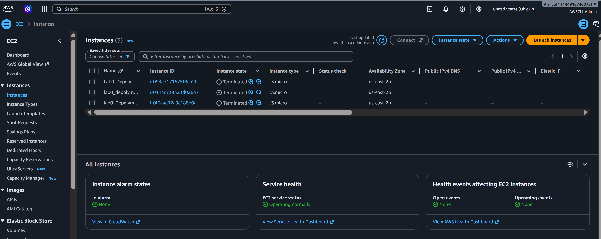

# seir_foundations_homework_wk1
Lab0_basics homework submission

Depolyment1     Public IPv4 address     Connection Method       Screenshot                  Instance term
1               18.223.182.87           EC2 Connect/SSH         
2               3.140.199.69            EC2 Connect/SSH         
3               13.184.20.89            EC2 Connect/SSH         

Using the AWS platform to launch a three EC2 instance to show the web page of the depolyed code.
CPU usage: 
The more you do it the better you fill in the template and created security groups.
There were errors in VS code in how to create declining folder or files.
Instances terminated: 